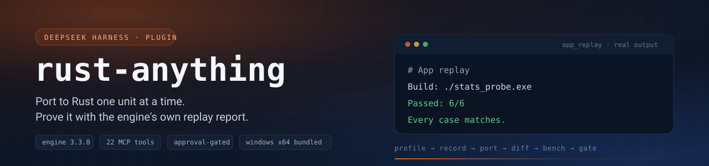
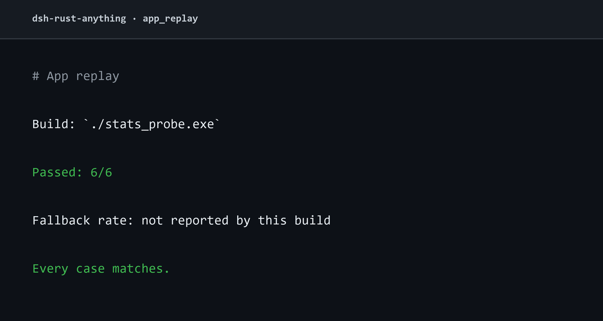

<div align="center">
  
</div>

> **This repository is a DeepSeek Harness plugin for [rust-anything](https://github.com/erkamyaman/rust-anything). It is not the rust-anything project and is not published by its maintainers.** The porting engine, its source and its licence belong to the upstream authors.
>
> What is maintained here is the DSH integration layer: packaging of the pinned engine, 22 MCP tools, the approval boundary, argument validation, the bundled skill and the release checker. The upstream source is not modified.
>
> The upstream documentation lists this plugin as a community integration ([agents.md](https://github.com/erkamyaman/rust-anything/blob/main/website/pages/en/docs/introduction/agents.md), added in [PR #709](https://github.com/erkamyaman/rust-anything/pull/709)) and marks it as not maintained by Rust Anything. That line names the pinned engine version, so it moves in the same release as the pin.

<div align="center">

[](https://github.com/lonyness/dsh-rust-anything/releases/latest)
[](https://github.com/lonyness/dsh-rust-anything/actions/workflows/test.yml)
[](#platforms-and-limitations)
[](#differences-from-the-upstream-cli)
[](#tools)
[](LICENSE)

<a href="#what-the-plugin-provides">Overview</a> ·
<a href="#installation">Installation</a> ·
<a href="#what-the-plugin-adds">Adapter features</a> ·
<a href="#differences-from-the-upstream-cli">vs upstream CLI</a> ·
<a href="#reading-a-replay-result">Replay results</a> ·
<a href="#tools">Tools</a> ·
<a href="#approvals">Approvals</a> ·
<a href="#platforms-and-limitations">Limitations</a> ·
<a href="README.zh-CN.md">简体中文</a>

</div>

---

## What the plugin provides

rust-anything reads a repository, selects the units worth rewriting, generates a Rust crate for one of them, and replays cases recorded from the original program against the Rust build. This plugin exposes that workflow inside DeepSeek Harness as 22 MCP tools, so the agent calls the engine through typed schemas instead of shell commands.

| Step | Tools | Output |
|:--|:--|:--|
| 1 | `analyze`, `map` | Units, port order, risks with `file:line`, and the bridge each unit requires. Read-only, no approval prompt. |
| 2 | `record` | Cases captured by running the original program: inputs, outputs, exit codes, written files. |
| 3 | `bridge`, `build` | A Rust crate with a language bridge (napi, PyO3, C ABI, cgo, Fiddle, JNI, PHP FFI, P/Invoke). |
| 4 | `diff`, `bench`, `gate` | Case-by-case comparison, timing on the workload, and the definition-of-done check. |

A unit counts as ported when its recorded cases match, `gate` passes, and `bench` reports that it is not slower when called the way its callers call it. Compilation alone does not.

The plugin targets existing programs in TypeScript/JavaScript, Python, C, Go, Ruby, Java, Kotlin, PHP or C# whose current behaviour has to survive the rewrite.

## Installation

**1. Install the bundle.** Stable plugin **3.3.5**, engine **rust-anything 3.3.0**.

```bash
dsh plugin --profile "my-profile" add "file:C:/Downloads/dsh-rust-anything-3.3.5.tgz"
```

The same bundle can be installed from the plugin page in the GUI or from the plugin market. The tarball is on [Releases](https://github.com/lonyness/dsh-rust-anything/releases/latest).

**2. Start with a read-only request.**

> Analyze this repository with rust-anything. List the five units to port first, the risks, and the bridge each one needs. Do not modify any files.

`analyze` and `map` are the only tools without an approval prompt, which makes this a low-risk way to confirm that the bundle, the engine and the platform are wired correctly.

**3. Approve one write.** The first write operation (`bridge`, `record`, `build`, …) asks for approval. Approval covers that call only.

## What the plugin adds

The engine is unchanged. The following is the adapter layer around it.

| Component | Behaviour |
|:--|:--|
| Bundled engine | Windows x64 ships the unmodified 3.3.0 executable. Its checksum is recorded in `runtime/upstream-v3.3.0.json`. There is no install step, no PATH lookup and no download at runtime. macOS and GNU Linux (x64/arm64) use a binary the user downloaded and verified. |
| Typed tools | 22 MCP tools with JSON Schemas, exposed as `mcp__rust-anything__*`. The agent reads the contract instead of the CLI syntax, and the same catalog validates every call. |
| Validation before approval | Wrong types, unknown keys, missing required fields, invalid enum values and the arguments the engine would silently reinterpret are refused before the approval prompt. The error names the field and the value it received. |
| Approval boundary | Only `analyze` and `map` skip approval, because the engine marks them read-only. The remaining 20 tools ask once per call. Under `never`, they are denied. |
| Cargo output inside the sandbox | Under Windows `workspace-write`, builds would otherwise write `%LOCALAPPDATA%\rust-anything\target` and be denied. The child process receives `CARGO_TARGET_DIR` inside the workspace: `<crate>/.rust-anything/target`, or `<project>/rust/.rust-anything/target` for composite calls. |
| Skill aligned with the engine | The injected skill states what the pinned engine supports: nine languages with the real limits (PHP bridges top-level functions only; PHP and C# have no `--batch`). It also links a [migration playbook](skills/rust-anything/playbook.md) covering compile-error diagnosis (`E0382`, `E0507`, `E0499`, `E0502`, `E0597`, `E0515`, `E0716`, `E0277`), FFI and `unsafe` review, and crate/feature matching against the target's `Cargo.toml`. |
| Replay guidance | The injected text requires `passed`, `total`, `skipped`, `failures` and `fallback` to be read together. A `2/2` at a 100% fallback rate is not a Rust result, and `fallback: null` means the build reported no rate, not that the rate is zero. |
| Release verification | `test/verify_release.py` compares the tarball against the npm publish list, compares every member with git `HEAD`, then unpacks the package and runs its tests. CI performs the same check on three platforms. |

## Differences from the upstream CLI

The engine behaves the same either way. The difference is the surrounding host.

| Aspect | Upstream CLI only | This plugin in DSH |
|:--|:--|:--|
| Obtaining the engine | Download per platform, unpack, keep on `PATH`, update manually | Pinned 3.3.0 executable in the package (Windows x64) with a recorded SHA-256; other platforms supply their own verified path through `DSH_RUST_ANYTHING_BIN` |
| Invocation | 22 subcommands and their flags | 22 typed tools, described by schema |
| Out-of-range numbers | `port: 70000` is dropped by `u16::try_from`, the HTTP request disappears and recording falls back to CLI mode; `timeout: -5` is read as "no timeout" and reverts to the configured 30 s; `pace: -5` keeps the previous value | Refused before approval: `app_record.port: expected an integer from 1 to 65535, got 70000` |
| Empty `run` | An empty list passed to `strings("run")` reuses the previously recorded command, so the new argument is ignored without notice | Refused: either a non-empty argv array whose first item names the program, or `run` omitted deliberately |
| Replay target | A non-string `--build` is ignored, the replay then runs through unit bindings, and the result looks like a pass | Refused: `app_replay.build` must be a single command-line string, and a library must omit it |
| Permission | Whatever the shell permits | One approval per call, with the read-only pair excepted; `never` denies the writes |
| Windows build cache | Writes outside the workspace, denied under `workspace-write` | `CARGO_TARGET_DIR` confined to the workspace |
| Version drift | Package updates and auto-updates can change the engine without notice | No auto-update, no PATH search, no runtime download; the pinned version is what runs |
| Telemetry | None | None; the only network traffic is what the build fetches |

Not changed by this plugin: the engine's logic, the `SKILL.md` bytes on disk (the two corrections are applied at injection time and both are recorded in [PROVENANCE](runtime/PROVENANCE.md)), the user's project files, and the engine version, which is not upgraded automatically. The plugin also does not guarantee that a completed port behaves identically in every environment; the recorded cases are the extent of the evidence.

## Reading a replay result

<div align="center">
  
</div>

The image is the engine's own report from a real DSH session, rendered from the saved file ([source and digest](docs/media/PROVENANCE.md)). A replay result consists of five values:

- `passed` / `total`: matched cases. A non-zero `skipped` means the run covered fewer cases than the total suggests.
- `failures`: each entry names the case and the difference. A single failure means the unit is not finished.
- `fallback`: the share of the run still answered by the original implementation. A `6/6` at a 100% fallback rate means the Rust code did not execute. `null` means the build did not report a rate.

## Tools

<details>
<summary><b>All 22 tools by phase</b></summary>

| Phase | Tools |
|:--|:--|
| Inspection, no approval prompt | `map`, `analyze` |
| Planning | `profile`, `bridge`, `package` |
| Recording and verification | `record`, `refresh`, `build`, `diff`, `bench`, `gate`, `report` |
| Switching a unit on or off | `shadow`, `enable`, `disable` |
| Performance | `go`, `fuzz` |
| Whole application | `app_record`, `app_replay`, `app_front_door`, `app_wire`, `app_lift` |

`rust_anything_prompt` is a read-only helper that returns the engine's migration prompt.

</details>

## Approvals

- `analyze` and `map` require no approval. The engine advertises them with `readOnlyHint: true`, `destructiveHint: false`, `openWorldHint: false`.
- Every other tool requires one approval per call, including the arguments.
- The plugin does not bypass host policy. A denied call remains denied; re-running it through a terminal, with `force`, or with the gate skipped is not a substitute.
- An error that names a field comes from the adapter's validation. The correct response is to change the argument.

## Platforms and limitations

| Platform | Engine |
|:--|:--|
| Windows x64 | Bundled. `DSH_RUST_ANYTHING_BIN` is deliberately ignored so that the shipped executable is the one that runs. |
| macOS / GNU Linux, x64 or arm64 | Supplied by the user: download the `v3.3.0` asset from the [upstream release](https://github.com/erkamyaman/rust-anything/releases/tag/v3.3.0), verify it against `SHA256SUMS`, and set `DSH_RUST_ANYTHING_BIN` to its absolute path. When building from source instead, `--version` must print `rust-anything 3.3.0`. |

Known limitations:

- Write operations require a permissive sandbox. On Windows, use `/permission workspace-write`; otherwise builds and gates fail when the engine writes its cache.
- Python units require a working interpreter. `record` and `go` try `python3`, then `python`. When `python` is the Microsoft Store stub, the call fails with `9009`; the adapter reports this, and an absolute interpreter path can be supplied as `app_record.run[0]`.
- Dependency downloads can fail behind a proxy. A build reporting `SEC_E_NO_CREDENTIALS` needs network or proxy configuration; disabling TLS verification is not an acceptable fix and the adapter does not do it.
- Large repositories are bounded. Four host variables set the limits:

| Variable | Default | Range |
|:--|--:|:--|
| `DSH_RUST_ANYTHING_STARTUP_TIMEOUT_MS` | 15000 | 1 – 120000 |
| `DSH_RUST_ANYTHING_REQUEST_TIMEOUT_MS` | 600000 | 1 – 3600000 |
| `DSH_RUST_ANYTHING_STDOUT_MAX_BYTES` | 16777216 | 1 – 67108864 |
| `DSH_RUST_ANYTHING_STDERR_MAX_BYTES` | 8192 | 1 – 65536 |

Coverage in this repository's CI: the bundled engine reproduces Unicode behaviour exactly (a case containing `é🦀` returns 2 in the original and 6 in a byte-oriented implementation, and the report names the difference). Build and replay are verified end to end for TypeScript, Python and C. The remaining six languages are verified for analysis and bridge generation only, because their toolchains are not present in CI.

## Verifying a release

```bash
python test/verify_release.py <upstream-v3.3.0-assets-dir> --tgz dsh-rust-anything-3.3.5.tgz
```

The script checks the official upstream checksums, then that the archive contains exactly the npm publish list with every member byte-identical to git `HEAD`, and finally that the unpacked package passes `node --test test/*.test.cjs`. `--self-check` verifies that the checker itself accepts a correct member set and rejects tampered, extra and missing members. Development requires `npm test` (Node 22.14+ and a Rust toolchain); see [runtime/PROVENANCE.md](runtime/PROVENANCE.md#maintainer-release-gate-from-the-checkout).

## Documentation

[Playbook](skills/rust-anything/playbook.md) · [Chinese acceptance scenarios](docs/acceptance-zh.md) · [Engine skill](skills/rust-anything/SKILL.md) · [Whole-app guide](skills/rust-anything/whole-app.md) · [Details](docs/DETAIL.md) · [Changelog](CHANGELOG.md) · [Tests](test/parity.test.cjs)

MIT licensed, as is the upstream engine. This is an unofficial integration: it is not affiliated with the rust-anything project and carries no endorsement from it. Removal: `dsh plugin --profile "my-profile" remove dsh-rust-anything`. Nothing outside the plugin directory is written, except Cargo output inside the workspace.
