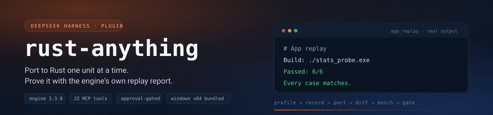
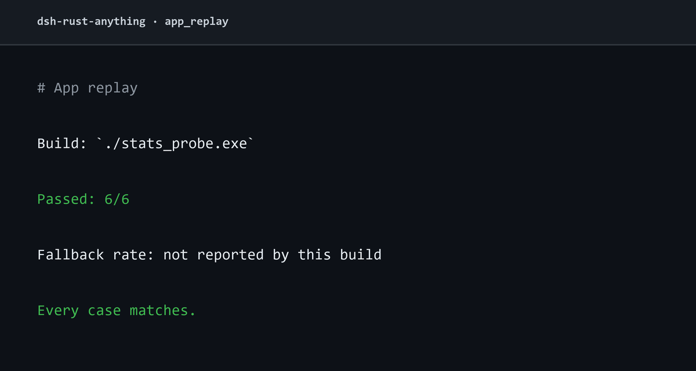

<div align="center">
  
</div>

<div align="center">

**rust-anything 引擎的 DeepSeek Harness 插件：有类型的工具、受审批的写操作，以及一份能逐条审计的回放报告。**

[](https://github.com/lonyness/dsh-rust-anything/releases/latest)
[](https://github.com/lonyness/dsh-rust-anything/actions/workflows/test.yml)
[](#平台与限制)
[](#对比直接运行原版)
[](#22-个工具)
[](LICENSE)

<a href="#它到底做什么">它做什么</a> ·
<a href="#60-秒上手">上手</a> ·
<a href="#这个插件补了什么">补了什么</a> ·
<a href="#对比直接运行原版">对比原版</a> ·
<a href="#怎么读证据">证据</a> ·
<a href="#22-个工具">工具</a> ·
<a href="#审批">审批</a> ·
<a href="#平台与限制">限制</a> ·
<a href="README.md">English</a>

</div>

---

## 它到底做什么

[rust-anything](https://github.com/erkamyaman/rust-anything) 是一个迁移引擎：读你的仓库、挑出值得重写的单元、为其中一个生成 Rust crate，再把它从**原程序**录制下来的用例回放到 Rust 构建上。这个包是那个引擎在 DeepSeek Harness 里的前端。它没有给你新增任何越权能力 —— 它做的是把引擎变成 22 个有类型的工具，并让证据始终跟在结论旁边。

工具强制走的循环：

| 步骤 | 工具 | 你拿到什么 |
|:--|:--|:--|
| 1 | `analyze` / `map` | 迁移单元、顺序、带 `file:line` 的风险，以及每个单元该用哪种桥接。只读，不弹审批。 |
| 2 | `record` | 通过真实运行原程序录下用例：输入、输出、退出码、写出的文件。 |
| 3 | `bridge` → `build` | 带真实语言桥接的 Rust crate（napi、PyO3、C ABI、cgo、Fiddle、JNI、PHP FFI、P/Invoke）。 |
| 4 | `diff` → `bench` → `gate` | 逐个用例比对、在你的负载上测速、跑完定义完成门禁。 |

编译通过不算迁完。用例对上、`gate` 通过、并且 `bench` 显示按调用方的方式调用它并不更慢，这个单元才算数。

**适合谁：** 你手上有一个能跑的程序（或一条热点路径），语言是 TypeScript/JavaScript、Python、C、Go、Ruby、Java、Kotlin、PHP 或 C#，你想换成 Rust，但不想丢掉现在已经依赖的行为。

## 60 秒上手

**1. 安装**（稳定版 **3.3.5**，引擎 **rust-anything 3.3.0**）：

```bash
dsh plugin --profile "my-profile" add "file:C:/Downloads/dsh-rust-anything-3.3.5.tgz"
```

也可以在 GUI 的插件页安装，或在插件市场里按名字装。tarball 从 [Releases](https://github.com/lonyness/dsh-rust-anything/releases/latest) 下载。

**2. 先问一个只读问题：**

> 用 rust-anything 分析这个仓库。给我最值得先迁的五个单元、风险，以及每个单元需要哪种桥接。不要改动任何文件。

`analyze` 和 `map` 是仅有的两个不需要审批就能跑的工具，所以这一步只花 token。

**3. 再批准一次构建。** 第一个写操作（`bridge`、`record`、`build` …）会问一次；批过之后，后面的循环就是正常干活。

## 这个插件补了什么

引擎是同一个，下面这些全是适配层：

| 方面 | 说明 |
|:--|:--|
| **自带引擎** | Windows x64 随包附带未经修改的 3.3.0 可执行文件，校验和固定在 `runtime/upstream-v3.3.0.json`。不用安装、不搜 PATH、运行时不下载。macOS 与 GNU Linux（x64/arm64）指向你自己下载并校验过的二进制。 |
| **有类型的工具，而不是背参数** | 22 个带 JSON Schema 的 MCP 工具，前缀 `mcp__rust-anything__*`。模型读契约而不是凭记忆敲命令，同一份固定目录在调用前做校验。 |
| **审批前就拦掉错误参数** | 类型错、未知键、缺必填、枚举值非法，以及引擎会**静默改写**的那些陷阱（见下方对比表），都在弹审批之前被拒；报错会点名字段和实到值，而不是给你一个看不懂的结果。 |
| **一次调用一次审批** | 只有 `analyze` 和 `map` 免审批，且仅因为引擎自己把它们标成只读。其余 20 个每次都要问一次；`never` 模式下会被拒绝。 |
| **Windows 沙箱下可编译** | 在 `workspace-write` 下，构建原本会去写 `%LOCALAPPDATA%\rust-anything\target` 而被拒；现在给子进程把 `CARGO_TARGET_DIR` 限定在工作区内 —— 直接调用是 `<crate>/.rust-anything/target`，组合调用是 `<project>/rust/.rust-anything/target`。 |
| **技能与引擎对齐** | 随包技能写的是这个固定引擎**真的**能做什么：九种语言，以及真实限制（PHP 只桥接顶层函数，PHP 与 C# 没有 `--batch`）；另有一份[迁移 playbook](skills/rust-anything/playbook.md)：编译错误诊断（E0382、E0507、E0499、E0502、E0597、E0515、E0716、E0277）、FFI 与 `unsafe` 审查、按你自己的 `Cargo.toml` 匹配 crate 与 feature。 |
| **提示里带着读证据的规矩** | 注入的指引要求模型把 `passed`/`total`/`skipped`/`failures`/`fallback` 合起来看，并明确：`2/2` 但回退率 100% 不是 Rust 的结果；`fallback: null` 只代表"没报告"，永远不等于 0。 |
| **发布物可复核** | `test/verify_release.py` 用 npm 发布清单比对 tarball 成员、拿 git `HEAD` 逐字节核对，再解包跑测试。三平台 CI 每次推送都做同样的事。 |

## 对比直接运行原版

同一个引擎，不同的周边。下面是引擎搬进 DSH 之后**真实改变了什么**：

| 方面 | 只跑 rust-anything CLI | DSH 里的这个插件 |
|:--|:--|:--|
| **拿到引擎** | 按平台下载、解包、放进 `PATH`、手动升级 | 包内固定 3.3.0 可执行文件（Windows x64），记录 SHA-256；其他平台用 `DSH_RUST_ANYTHING_BIN` 指向你自己校验过的路径 |
| **怎么调用** | 记 22 个子命令和各自的参数 | 22 个有类型的工具，模型读 schema 而不是猜 |
| **数值越界** | `port: 70000` 被 `u16::try_from` 丢弃，HTTP 请求消失，录制静默降级成 CLI 模式；`timeout: -5` 变成"没给超时"、回落到配置的 30 秒；`pace: -5` 保留旧值 | 审批前拒绝：`app_record.port: expected an integer from 1 to 65535, got 70000` |
| **空的 `run`** | 空列表进 `strings("run")` 就复用上次录过的命令 —— 你以为重录了 `php other.php`，其实录的是旧命令 | 拒绝：要么给非空 argv 且首项是程序名，要么你明确省略 `run` |
| **回放目标** | 本该传字符串的地方传了别的，引擎直接当没传，然后走单元绑定回放，看着像通过 | 拒绝：`app_replay.build` 必须是一条命令行字符串；库必须省略它 |
| **权限** | shell 允许什么就能干什么 | 每次调用单独授权，只有那一对只读工具例外；`never` 下写操作被拒 |
| **Windows 构建缓存** | 往工作区外写，在 `workspace-write` 下被拒 | `CARGO_TARGET_DIR` 限定在工作区内 |
| **版本漂移** | npm 与自动更新会在你脚下换引擎 | 不自动更新、不搜 PATH、运行时不下载 —— 跑的就是固定那一版 |
| **遥测** | — | 没有。唯一的网络流量是你自己的构建拉下来的依赖。 |

**它刻意不改的东西：** 引擎逻辑；磁盘上的 `SKILL.md` 原文件（两处纠正在注入时生效，[PROVENANCE](runtime/PROVENANCE.md) 记录了两者的差异）；你的项目文件；也不承诺"迁完之后在任何地方行为完全一致"。它同样不会替你升级引擎，即使上游发了新版。

## 怎么读证据

<div align="center">
  
</div>

这是引擎自己在真实 DSH 会话里写的报告，从保存下来的文件渲染而来（[来源与哈希](docs/media/PROVENANCE.md)）。一次回放是五个数，不是一个：

- `passed` / `total` —— 对上的用例数。`skipped` 大于 0 意味着这次验证比看上去少。
- `failures` —— 每条都点名用例和差异。有一条失败就是这个单元没迁完，不是"误差"。
- `fallback` —— 这次回放里还有多少仍由原实现作答。`6/6` 配上 100% 回退率，说明 Rust 代码根本没跑过。`null` 表示这个构建没报告回退率，和 `0` 不是一回事。

## 22 个工具

<details>
<summary><b>按阶段看完整列表</b></summary>

| 阶段 | 工具 |
|:--|:--|
| 看 —— 不弹审批 | `map`、`analyze` |
| 规划 | `profile`、`bridge`、`package` |
| 录制与证明 | `record`、`refresh`、`build`、`diff`、`bench`、`gate`、`report` |
| 开关单元 | `shadow`、`enable`、`disable` |
| 提速 | `go`、`fuzz` |
| 整应用 | `app_record`、`app_replay`、`app_front_door`、`app_wire`、`app_lift` |

`rust_anything_prompt` 是只读辅助工具，返回引擎自带的迁移提示模板。

</details>

## 审批

- `analyze` 与 `map` 免审批，因为引擎用 `readOnlyHint: true`、`destructiveHint: false`、`openWorldHint: false` 声明了它们只读。
- 其余每次调用都单独问一次，附带确切参数。批过一次不等于长期授权。
- 这里没有绕过宿主的后门：被拒的工具就是被拒。换终端重跑、加 `force`、跳过 gate 都不算绕法，技能里也这么写着。
- 报错点名了字段，就是适配层在干活 —— 改参数，而不是原样重试。

## 平台与限制

| 平台 | 引擎 |
|:--|:--|
| Windows x64 | 随包附带。这里故意忽略 `DSH_RUST_ANYTHING_BIN`，保证跑的就是随包那一个。 |
| macOS / GNU Linux（x64 或 arm64） | 自己提供：从[上游 v3.3.0 Release](https://github.com/erkamyaman/rust-anything/releases/tag/v3.3.0) 下载对应资产，用 `SHA256SUMS` 校验后把 `DSH_RUST_ANYTHING_BIN` 设为它的绝对路径。若自己从源码构建，`--version` 应打印 `rust-anything 3.3.0`。 |

如实写出的已知限制：

- **写操作需要放开的沙箱。** Windows 上用 `/permission workspace-write`，否则构建和 gate 会在引擎的缓存目录上失败。
- **Python 单元需要可用的解释器。** `record` 与 `go` 先探 `python3`、再探 `python`。如果机器上的 `python` 是应用商店存根，会拿到 `9009`；适配层会把这个诊断出来，你也可以在 `app_record.run[0]` 里写绝对解释器路径。
- **代理后面的依赖下载会失败。** 报 `SEC_E_NO_CREDENTIALS` 时需要处理网络或代理配置。不要靠关掉 TLS 校验来"修"它 —— 适配层不会这么做。
- **大仓库是被有意限住的。** 四个宿主变量可以在不把编译器重新放开成无边界工作的前提下调节：

| 变量 | 默认值 | 范围 |
|:--|--:|:--|
| `DSH_RUST_ANYTHING_STARTUP_TIMEOUT_MS` | 15000 | 1 – 120000 |
| `DSH_RUST_ANYTHING_REQUEST_TIMEOUT_MS` | 600000 | 1 – 3600000 |
| `DSH_RUST_ANYTHING_STDOUT_MAX_BYTES` | 16777216 | 1 – 67108864 |
| `DSH_RUST_ANYTHING_STDERR_MAX_BYTES` | 8192 | 1 – 65536 |

本仓库 CI 已确认：随包引擎能精确复现 Unicode 行为（含 `é🦀` 的用例，原版得 2、按字节处理的实现得 6 —— 报告会点名差异而不是掩盖它）。构建与回放端到端验证覆盖 TypeScript、Python、C；其余六种语言只验证到"分析与桥接产出真实文件"，因为 CI 里没有对应工具链。

## 验证下载物

```bash
python test/verify_release.py <上游 v3.3.0 资产目录> --tgz dsh-rust-anything-3.3.5.tgz
```

它会先核对上游官方校验和，再确认 tarball 的成员与 npm 发布清单完全一致、每个成员与 git `HEAD` 逐字节相同，最后解包跑 `node --test test/*.test.cjs`。`--self-check` 用来证明这个校验器自己会接受正确集合、并分别拒绝被篡改、多出或缺失的成员。参与开发：`npm test`（Node 22.14+ 与 Rust 工具链），细节见 [runtime/PROVENANCE.md](runtime/PROVENANCE.md#maintainer-release-gate-from-the-checkout)。

## 文档

[Playbook](skills/rust-anything/playbook.md) · [中文验收场景](docs/acceptance-zh.md) · [引擎技能](skills/rust-anything/SKILL.md) · [整应用指南](skills/rust-anything/whole-app.md) · [细节](docs/DETAIL.zh.md) · [变更记录](CHANGELOG.md) · [测试](test/parity.test.cjs)

MIT 许可，与上游引擎一致。非官方集成：与 rust-anything 项目无隶属关系，也未获其背书。卸载：`dsh plugin --profile "my-profile" remove dsh-rust-anything`；除了插件目录本身，只会在工作区内产生 Cargo 构建输出。
